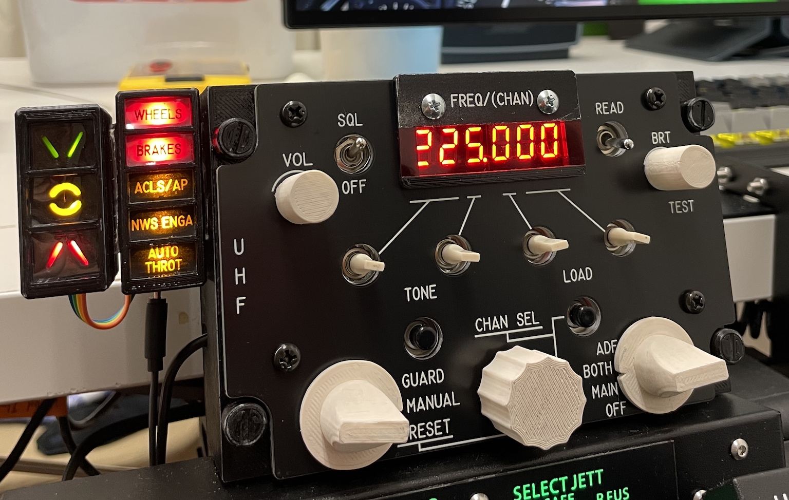
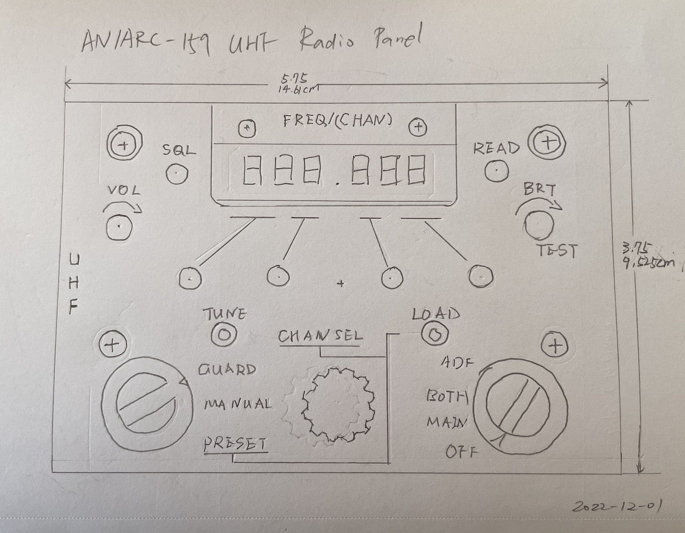
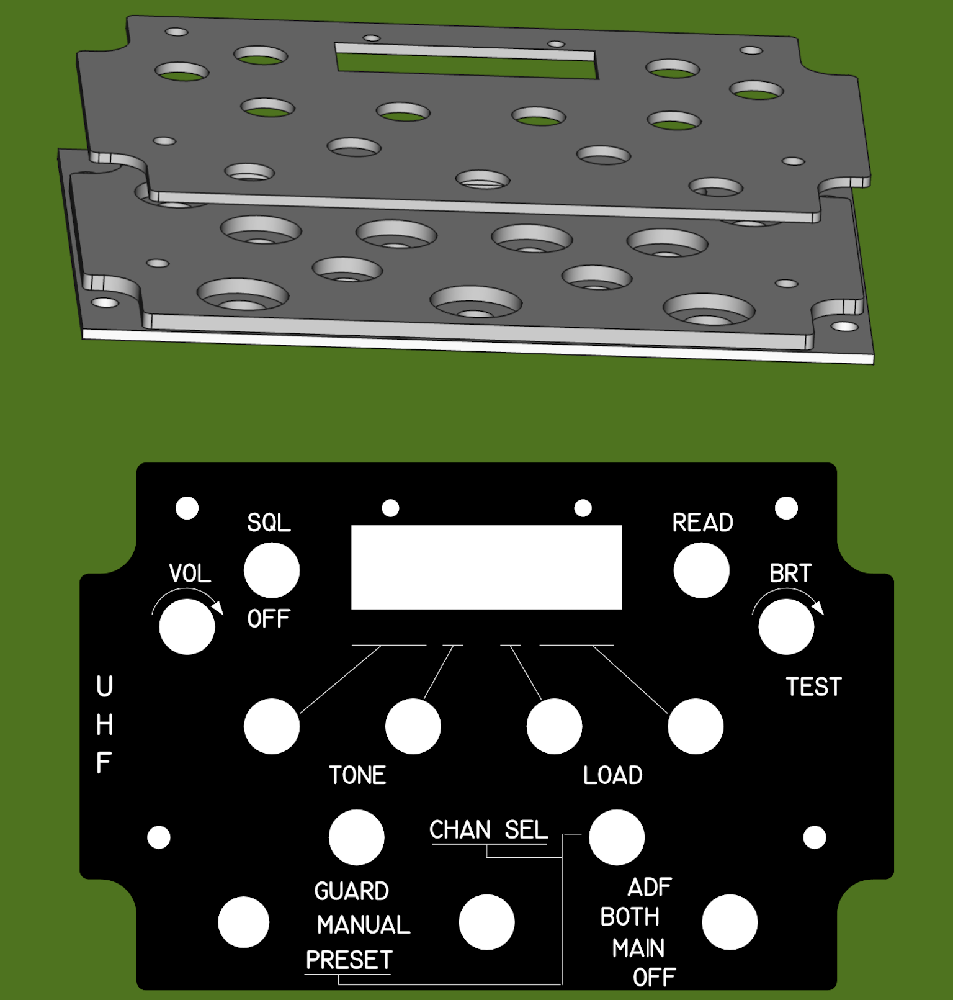

# F-14B Tomcat ARC-159 Radio Panel

AN/ARC-159(V) 1 UHF Control Panel for DCS F-14B Tomcat. Built with Arduino compatible microcontroller board Mega 2560 Pro Mini, use with [DCS-Skunkworks DCS-BIOS fork](https://github.com/DCS-Skunkworks/dcs-bios).

## Parts

* Mega 2560 Pro Mini Board
* TM1637 6-Digit 7-Segment LED
* Mini toggle switches:
  * 4 (on)-off-(on) for frequency dials
  * 1 on-off for SQL
  * 1 (on)-off for READ
* 2 potentiometers for VOL and BRT
* 1 rotary encoder for preset channel selector
* 2 rotary switches for mode selector and function selector
* 2 push buttons for TUNE and LOAD

## Design

This is the final panel (AoA Indexer excluded, for AoA Indexer design see [here](../AoA%20Indexer)).



The size of the original AN/ARC-159(V) is **5.75** inch in width and **4.875** inch in height. I don't need the frequency chart to record preset channel frequencies, so that part is removed from my design to make the panel size smaller:

* width: **5.75** (14.61cm)
* height: **3.75** (9.525cm)



I design the panel using FreeCAD. It consists of three layers. The bottom and middle layers are composed and 3D printed as a single object.

Note the hole diameters are determined by looking at switches, buttons and encoders I have. They are likely to not fit for others.



## Mega 2560 Pro Mini PINs Usage

Mega 2560 Pro Mini has enough digital PINs to connect each throw of the (On)-Off-(On) toggle switches and rotary switches directly. The sketch uses `INPUT_PULLUP`, so each switch contact should connect the selected PIN to ground. Inputs are sent directly to DCS-BIOS instead of enumerating as a USB joystick.

|  PIN  | ARC-159 Function     | Button/Switch          | DCS-BIOS Control              | Note                      |
|:-----:|----------------------|------------------------|-------------------------------|---------------------------|
|   2   | Chan Sel             | Rotary Encoder 0 CLK   | `PLT_UHF1_PRESETS`            | INC                       |
|   3   | Chan Sel             | Rotary Encoder 0 DT    | `PLT_UHF1_PRESETS`            | DEC                       |
|   4   | Freq LED             | TM1637 LED DIO         | DCS-BIOS Output               |                           |
|   5   | Freq LED             | TM1637 LED CLK         | DCS-BIOS Output               |                           |
|   6   | Tone                 | Push Button 0          | `PLT_UHF1_TONE`               |                           |
|   7   | Load                 | Push Button 1          | `PLT_UHF1_LOAD`               |                           |
|   8   | SQL                  | On-Off Toggle Switch 0 | `PLT_UHF1_SQUELCH`            |                           |
|   9   | Read                 | (On)-Off Switch 0      | `PLT_UHF1_SHOW_PRESET_FREQ`   |                           |
|   10  | ❌                   | Rotary Encoder 0 SW    | `PLT_UHF_DISPLAY_TEST`        | Misc button *1            |
|   A0  | VOL                  | Potentiometer 0        | `PLT_UHF1_VOL`                |                           |
|   A1  | BRT                  | Potentiometer 1        | `PLT_UHF1_BRIGHTNESS`         |                           |
|   22  | Freq 10MHz Switch    | (On)-Off-(On) Switch 0 | `PLT_UHF1_110_DIAL`           | INC                       |
|   23  | Freq 10MHz Switch    | (On)-Off-(On) Switch 0 | `PLT_UHF1_110_DIAL`           | DEC                       |
|   24  | Freq 1MHz Switch     | (On)-Off-(On) Switch 1 | `PLT_UHF1_1_DIAL`             | INC                       |
|   25  | Freq 1MHz Switch     | (On)-Off-(On) Switch 1 | `PLT_UHF1_1_DIAL`             | DEC                       |
|   26  | Freq 0.1MHz Switch   | (On)-Off-(On) Switch 2 | `PLT_UHF1_01_DIAL`            | INC                       |
|   27  | Freq 0.1MHz Switch   | (On)-Off-(On) Switch 2 | `PLT_UHF1_01_DIAL`            | DEC                       |
|   28  | Freq 0.025MHz Switch | (On)-Off-(On) Switch 3 | `PLT_UHF1_025_DIAL`           | INC                       |
|   29  | Freq 0.025MHz Switch | (On)-Off-(On) Switch 3 | `PLT_UHF1_025_DIAL`           | DEC                       |
|   30  | Mode Selector        | Rotary Switch 0        | `PLT_UHF1_FREQ_MODE`          | Position 0                |
|   31  | Mode Selector        | Rotary Switch 0        | `PLT_UHF1_FREQ_MODE`          | Position 1                |
|   32  | Mode Selector        | Rotary Switch 0        | `PLT_UHF1_FREQ_MODE`          | Position 2                |
|   33  | Function Selector    | Rotary Switch 1        | `PLT_UHF1_FUNCTION`           | Position 0                |
|   34  | Function Selector    | Rotary Switch 1        | `PLT_UHF1_FUNCTION`           | Position 1                |
|   35  | Function Selector    | Rotary Switch 1        | `PLT_UHF1_FUNCTION`           | Position 2                |
|   36  | Function Selector    | Rotary Switch 1        | `PLT_UHF1_FUNCTION`           | Position 3                |

* *1: F-14B Radio Panel doesn't have a center push button on the CHAN SEL knob; the rotary encoder button is mapped to display test as a useful spare input.

## DCS-BIOS

This radio control panel works in DCS-BIOS mode.

1. Inputs: All switches, buttons and rotary encoders send F-14B ARC-159 DCS-BIOS control messages.
1. Outputs: The TM1637 LED interfaces with DCS-BIOS to display F-14B radio channel or frequency based on mode. When in F-14B Rio seat, it will display the AN/ARC-182 info as well. Currently these F-14B seats are supported:
  * F-14B Front Seat
  * F-14B Back Seat (RIO)

## Arduino Libraries

* [DCS-Skunkworks DCS-BIOS Arduino Library](https://github.com/DCS-Skunkworks/dcs-bios)
* [TM1637TinyDisplay](https://github.com/jasonacox/TM1637TinyDisplay)

## PlatformIO

The panel folder is also a PlatformIO project. The default environment targets the Mega 2560 Pro Mini:

```sh
cd "Radio Panel"
pio run
```

## License

Available under MIT license.
